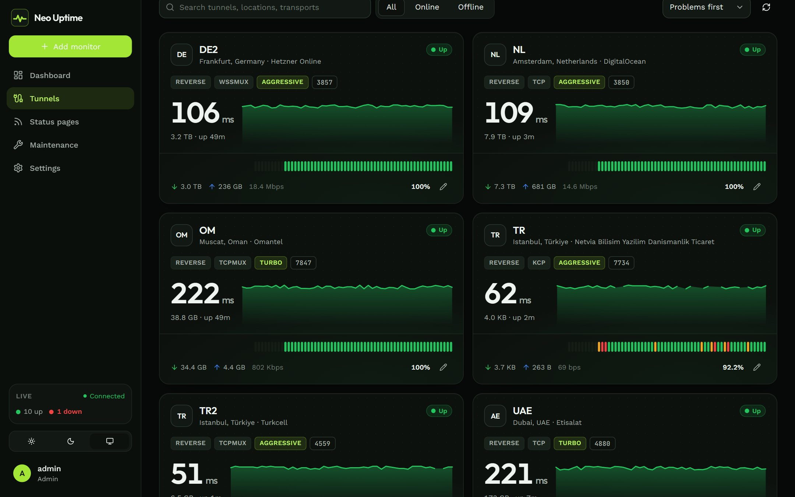
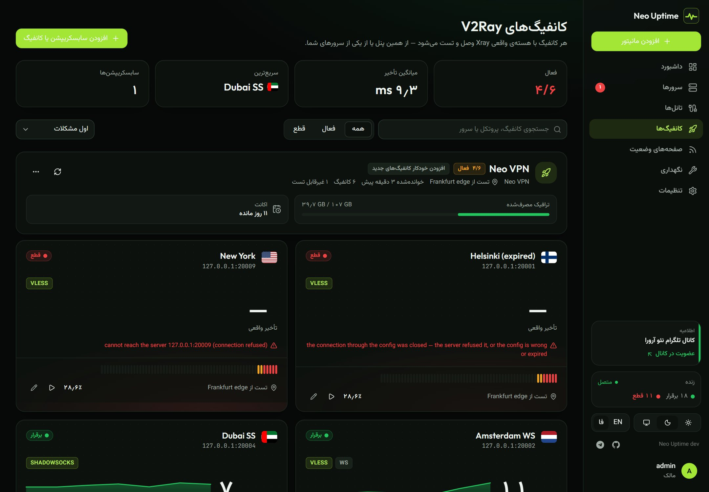
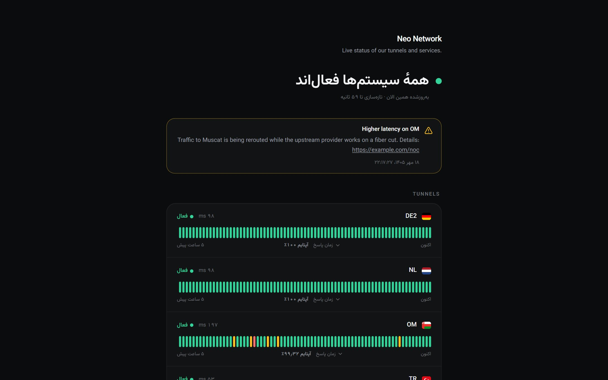

<div align="center">


# Neo Uptime

<div dir="rtl">

**مانیتورینگ ساده و فارسی برای سرورها، تانل‌های BackPack و Kariz و کانفیگ‌های V2Ray**

هر وقت سرور، تانل یا کانفیگی قطع یا کند شد، در تلگرام خبرتان می‌کند.

[کانال تلگرام](https://t.me/neoaurora) · [نصب](#نصب) · [دستورات مهم](#دستورات-مهم)

</div>



</div>

<div dir="rtl">

## نصب

روی یک سرور لینوکس (اوبونتو، دبیان و …) با کاربر root این دستور را بزنید:

```bash
bash <(curl -fsSL https://raw.githubusercontent.com/neoauroraproject/Neo-Uptime/main/install.sh)
```

پورت را می‌پرسد (با Enter همان `7788` می‌ماند). بعد آدرس `http://IP-سرور:7788` را در مرورگر باز کنید و حساب مدیر را بسازید.

اگر همین دستور را دوباره بزنید، یک منو می‌آید:

```
  1) Update to the latest version     ← آپدیت
  2) Change the port                  ← تغییر پورت
  3) Restart                          ← ری‌استارت
  4) Status and recent logs           ← وضعیت و لاگ
  5) Reset a user's password          ← بازنشانی رمز
  6) Uninstall (keep the data)        ← حذف برنامه (اطلاعات می‌ماند)
  7) Uninstall and delete all data    ← حذف کامل
```

> اگر گیت‌هاب روی سرورتان کند یا فیلتر است، آخر دستور `--mirror https://آدرس-میرور/` اضافه کنید.

## چه کارهایی می‌کند؟

- **تانل‌های BackPack و Kariz:** وضعیت، پینگ، ترافیک و مدت اتصال هر تانل، با نمودار و تاریخچه.
- **سرورها:** پردازنده، رم، دیسک و ترافیک هر سرور.
- **کانفیگ‌های V2Ray:** لینک سابسکریپشن یا کانفیگ (vless، vmess، trojan، ss، hysteria2) را بدهید؛ هر کانفیگ با هسته‌ی واقعی Xray وصل و تست می‌شود — حتی از سرور ایران.
- **هشدار:** تلگرام، بله، دیسکورد، ایمیل و … — وقتی چیزی قطع شد، دوباره وصل شد یا کند شد.
- **صفحه‌ی وضعیت:** یک صفحه‌ی زیبا برای مشتری‌ها، روی دامنه‌ی خودتان و با SSL رایگان.
- **پنل فارسی:** راست‌به‌چپ، اعداد فارسی و تاریخ شمسی؛ روشن و تیره.
- **وب‌سایت، پورت، پینگ، DNS، دیتابیس** و بیش از ۲۵ نوع مانیتور دیگر.



## اضافه کردن سرور (تانل‌ها)

لازم نیست Neo Uptime روی همان سروری باشد که تانل‌ها روی آن هستند.

۱. در پنل به **سرورها ← افزودن سرور** بروید، اسم و پرچم بدهید.
۲. دستوری را که نشان می‌دهد روی همان سرور (با root) اجرا کنید. چیزی شبیه این است:

```bash
bash <(curl -fsSL https://raw.githubusercontent.com/neoauroraproject/Neo-Uptime/main/agent.sh) --server http://IP:7788 --token na_xxxx
```

۳. چند ثانیه بعد سرور آنلاین می‌شود و تانل‌هایش خودکار اضافه می‌شوند.

**سرور ایران وصل نمی‌شود؟** بالای دستور نصب گزینه‌ی **«از داخل تانل»** را انتخاب کنید و پورت `7788` را به پورت‌های تانل اضافه کنید؛ گزارش‌ها از داخل تانل می‌آیند و فیلترینگ اثری ندارد. روی کارت سرور آفلاین هم دکمه‌ی **بررسی دوباره** و راهنمای رفع مشکل هست.

## تست کانفیگ‌های V2Ray

۱. **افزودن مانیتور ← کانفیگ‌های V2Ray** را بزنید.
۲. لینک سابسکریپشن را بچسبانید (یا **تک کانفیگ** و لینک `vless://…`).
۳. در **تست از** انتخاب کنید تست از کجا انجام شود: همین پنل، یا سرور ایران تا همان چیزی را ببینید که کاربران ایران می‌بینند.
۴. کانفیگ‌ها را تیک بزنید و **شروع مانیتورینگ**.

در صفحه‌ی **کانفیگ‌ها** برای هر کانفیگ تأخیر واقعی، نمودار و علت قطعی (سرور در دسترس نیست، کانفیگ رد شد، گواهی نامعتبر و …) دیده می‌شود، و برای هر سابسکریپشن حجم مصرف‌شده و روزهای باقی‌مانده. کانفیگ‌های جدید سابسکریپشن خودکار اضافه می‌شوند.

> برای تست از سرور ایران، ایجنت آن سرور باید نسخه‌ی ۱.۳ یا جدیدتر باشد: دستور نصب ایجنت را دوباره روی آن سرور بزنید و **1) Update** را انتخاب کنید.

## هشدار تلگرام

۱. با [@BotFather](https://t.me/BotFather) یک ربات بسازید و توکنش را کپی کنید.
۲. یک پیام به ربات بفرستید (یا ربات را به گروه یا کانالتان اضافه کنید).
۳. در **تنظیمات ← اعلان‌ها ← افزودن کانال ← تلگرام** توکن را بگذارید، **یافتن چت‌ها** را بزنید، چت را انتخاب کنید و پیام آزمایشی بفرستید.

اگر تلگرام روی سرورتان فیلتر است، در همان فرم یک پراکسی (`socks5://…`) بگذارید.

**هشدار کندی:** مثلاً «اگر پینگ بیشتر از ۳۰۰ میلی‌ثانیه به مدت ۲ دقیقه ماند خبر بده». برای همه‌ی تانل‌ها با هم: دکمه‌ی **هشدار کندی** در صفحه‌ی تانل‌ها.

## صفحه‌ی وضعیت

در **صفحه‌های وضعیت** یک صفحه بسازید، سرورها و تانل‌ها را اضافه کنید، لوگو بگذارید و پوسته را انتخاب کنید. می‌توانید هر چیزی را که نمی‌خواهید مشتری ببیند (پورت، نوع انتقال، ترافیک و …) مخفی کنید.

**دامنه‌ی اختصاصی با SSL:** یک رکورد A (مثلاً `status.example.com`) به IP سرور بسازید (در کلودفلر حالت *DNS only*)، دامنه را در ویرایشگر صفحه بنویسید و **دریافت فوری SSL** را بزنید. صفحه روی `https://status.example.com` و بدون پورت باز می‌شود.



## دستورات مهم

| کار | دستور |
|---|---|
| آپدیت | دستور نصب را دوباره بزنید و `1` را انتخاب کنید |
| فراموشی رمز | `neo-uptime reset-password admin` |
| گم شدن گوشی (غیرفعال کردن ورود دومرحله‌ای) | `neo-uptime disable-2fa admin` |
| دیدن لاگ | `journalctl -u neo-uptime -f` |
| ری‌استارت | `systemctl restart neo-uptime` |
| تست ایجنت روی سرور دیگر | `neo-uptime-agent test` |
| حذف | دستور نصب را دوباره بزنید و `6` یا `7` را انتخاب کنید |

به‌جای `admin` نام کاربری خودتان را بنویسید. دستور بازنشانی رمز، یک رمز تازه چاپ می‌کند.

## اطلاعیه‌ها

پنل هر چند ساعت فایل اطلاعیه‌های این پروژه ([`ads.json`](ads.json)) را از گیت‌هاب می‌خواند و بالای داشبورد و در منو نشان می‌دهد. هیچ اطلاعاتی از سرور شما فرستاده نمی‌شود.

## بیشتر

- اخبار و نسخه‌های جدید: [کانال تلگرام @neoaurora](https://t.me/neoaurora)
- راهنمای فنی (گزینه‌های نصب، Docker، API، nginx، توسعه): [docs/advanced.md](docs/advanced.md)
- مجوز: [MIT](LICENSE). این برنامه از [Xray-core](https://github.com/XTLS/Xray-core) (مجوز MPL-2.0) و پرچم‌های [flag-icons](https://github.com/lipis/flag-icons) (MIT) استفاده می‌کند.

</div>
