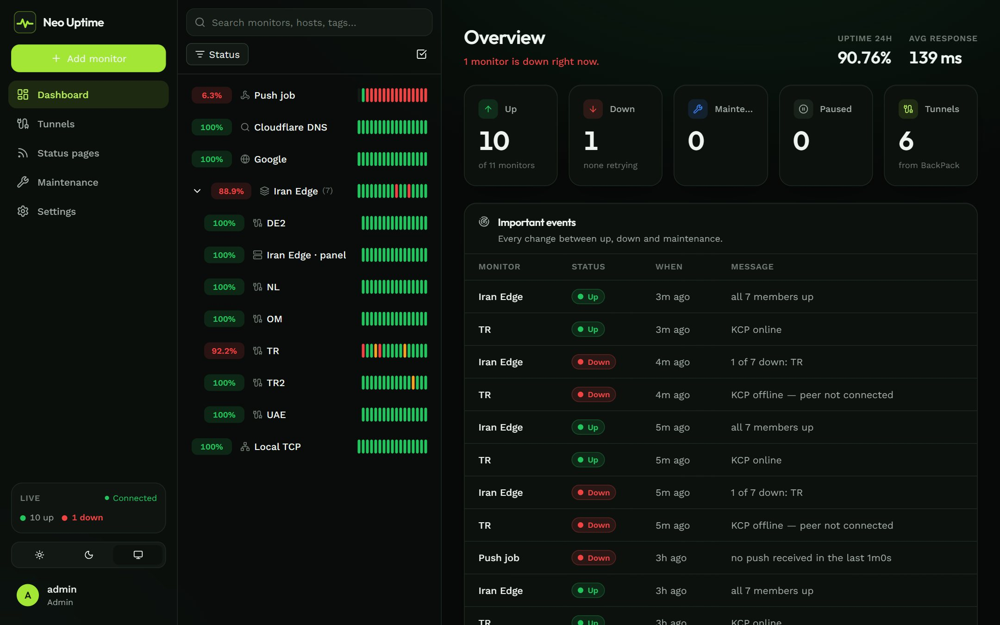
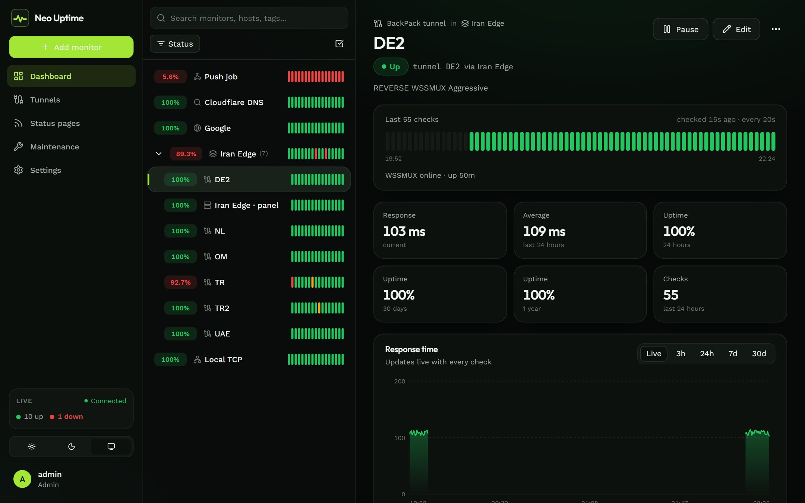
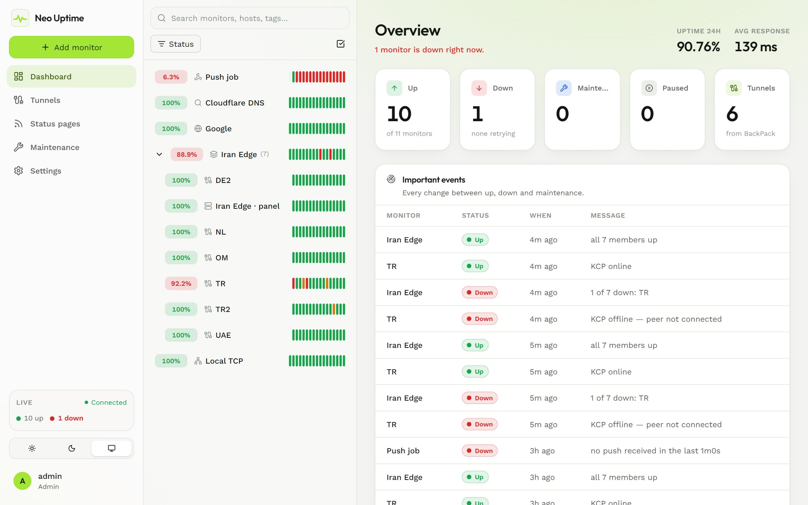
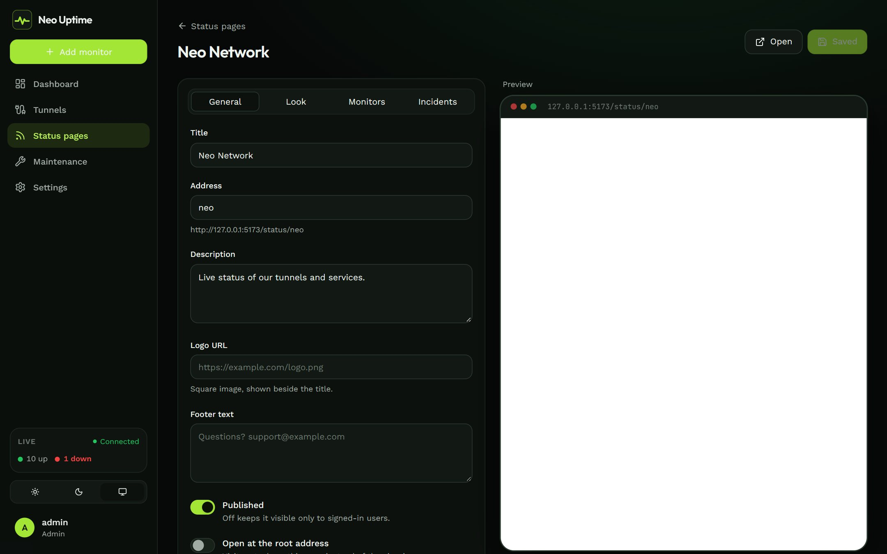
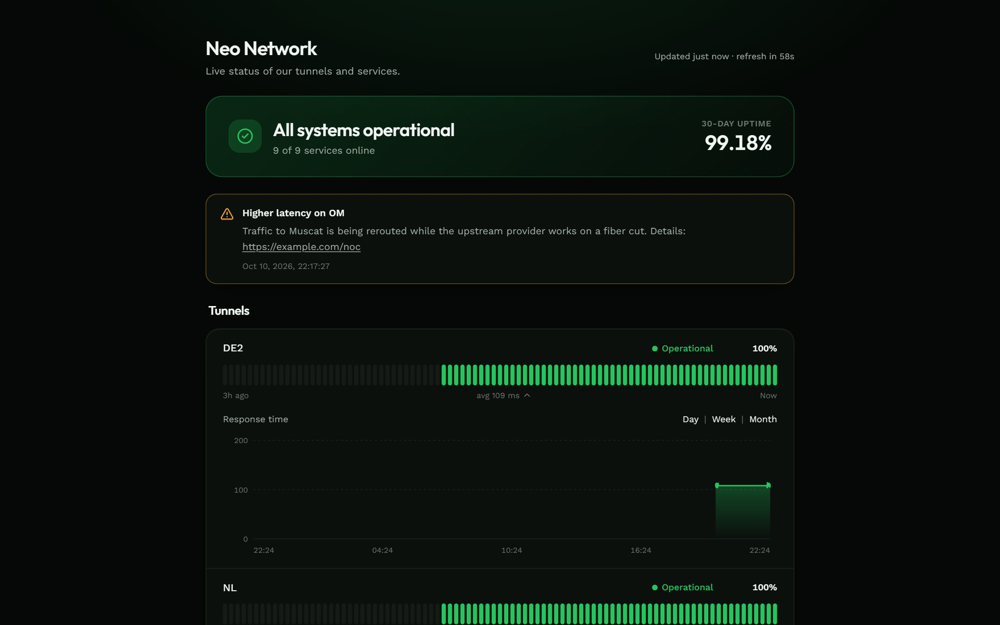
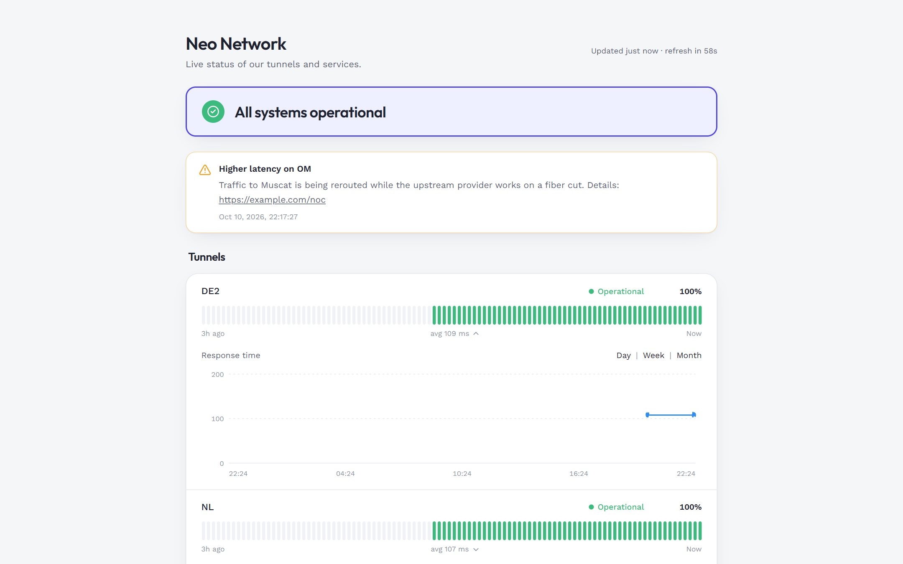
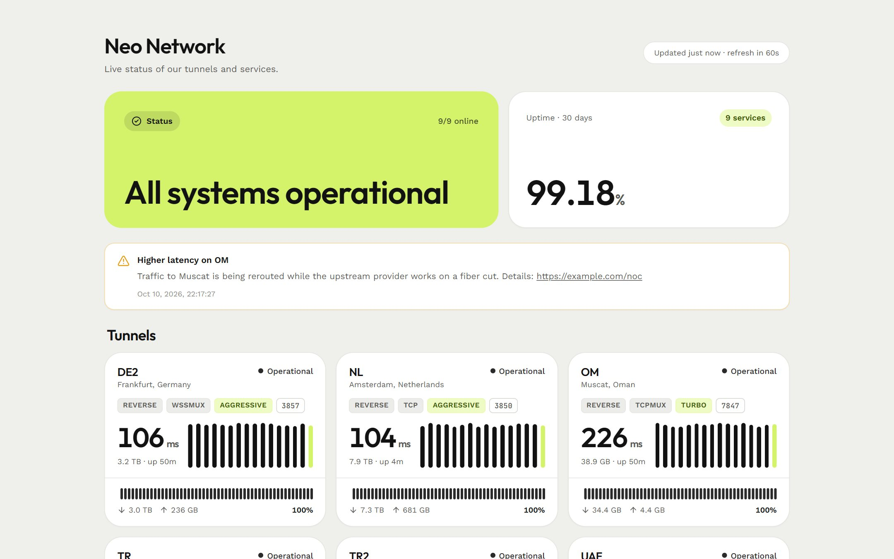
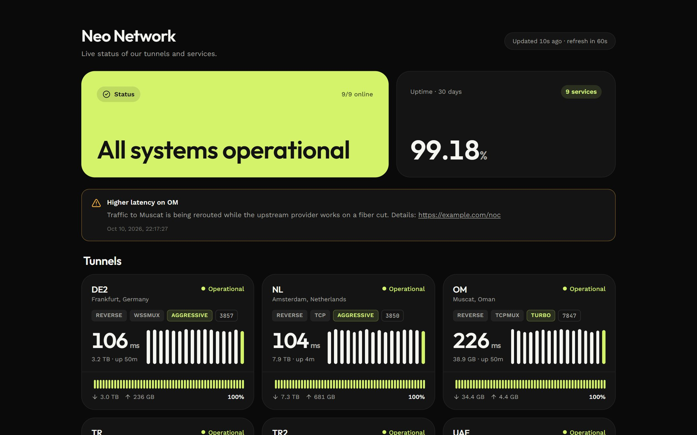

<div align="center">


# Neo Uptime

**Self-hosted uptime monitoring with first-class [BackPack](https://github.com/AminMGMT/BackPack) tunnel support.**
Uptime Kuma-style monitors, a full admin panel, four status-page themes — in one small binary.

[Install](#install) · [BackPack tunnels](#monitor-backpack-tunnels) · [Status pages](#status-pages) · [فارسی](#فارسی)


</div>

## Install

On a Linux server (Ubuntu, Debian, CentOS, Alma, …), as root:

```bash
bash <(curl -fsSL https://raw.githubusercontent.com/neoauroraproject/Neo-Uptime/main/install.sh)
```

Then open `http://SERVER-IP:7788` and create the admin account. Running the same command again upgrades in place and keeps every monitor and all history.

| Option | |
|---|---|
| `--port 8080` | listen on another port (default `7788`) |
| `--version v1.0.0` | install a specific release |
| `--mirror https://your-gh-proxy/` | download through a GitHub mirror when GitHub is slow or filtered |
| `--uninstall` / `--uninstall --purge` | remove the service (and, with `--purge`, the data) |

Supported CPUs: `amd64`, `arm64`, `armv7`. The binary is static: no Node, no database server, no Docker needed.

<details>
<summary>Docker instead</summary>

```bash
docker run -d --name neo-uptime --restart=always -p 7788:7788 \
  -v neo-uptime:/data --cap-add NET_RAW ghcr.io/neoauroraproject/neo-uptime:latest
```
</details>

## Features

- **14 monitor types:** HTTP(s), HTTP keyword, HTTP JSON query, TCP port, ping (ICMP), DNS, push (heartbeat), Docker container, PostgreSQL, MySQL/MariaDB, Redis, group, **BackPack tunnel** and **BackPack panel**.
- **Kuma-style checks:** per-monitor intervals, retries with their own interval, timeouts, upside-down mode, re-sent alerts while down, and TLS certificate expiry warnings.
- **Live dashboard:** a two-pane monitor list with heartbeat bars, groups, tags, search, filters and bulk pause/resume/delete. A server-sent event stream updates it without reloading.
- **Monitor pages:** response-time charts (live, 3h, 24h, 7d, 30d), 24h/30d/1-year uptime, important events and full check history.
- **11 notification channels:** Telegram (with a custom API server and proxy, for when it is filtered), Bale, Discord, Slack/Mattermost, Microsoft Teams, Google Chat, email (SMTP), webhook (Kuma-compatible body), ntfy, Gotify and Pushover.
- **Status pages:** as many as you like, in four themes and two layouts, with 90-day bars, incidents, scheduled maintenance, a logo, custom CSS and a live preview editor.
- **Maintenance windows:** manual, one-time, weekly or monthly, in any time zone, and they can cross midnight. Groups pass their maintenance down to their members.
- **Admin:** multiple users with admin, editor and viewer roles, two-factor sign-in (TOTP), per-device sessions, scoped and expiring API keys, and JSON backup/restore.
- **Integrations:** a Prometheus `/metrics` endpoint (with Kuma's metric names) and SVG badges for status, uptime, response time and certificate expiry.
- **Light and dark admin themes.** Fonts are bundled, so nothing loads from Google or any CDN.

<table>
<tr><td></td><td></td></tr>
<tr><td></td><td></td></tr>
</table>

## Monitor BackPack tunnels

Neo Uptime reads the same read-only API that BackPack documents for Prometheus, so it never touches a tunnel's config.

1. In the **BackPack web panel** go to **Settings → Security → API tokens**, create a token with scope **read** and name it `neo-uptime`.
2. In Neo Uptime go to **Tunnels → Panels → Connect panel**. Paste the panel address exactly as you open it, including the port and any secret path (for example `https://1.2.3.4:7777`), then paste the token and click **Test connection**.
3. Save. Every tunnel becomes a monitor inside a group named after the panel, together with a panel-health monitor (host CPU, RAM and disk). With **auto-import** on, tunnels you add in BackPack later show up on their own.

Each tunnel monitor records its online state, real latency, traffic in and out, uptime, transport, preset, port, peer location, KCP loss and connection pool. The **Tunnels** page shows them as cards in the style of BackPack's own monitor, with uptime history added. A tunnel that is up while the service behind it refuses connections can be counted as down: turn this on per monitor.

## Push monitors (Uptime Kuma compatible)

A push monitor gives you a URL in the same format as Kuma's:

```bash
curl -fsS "https://uptime.example.com/api/push/<token>?status=up&msg=OK&ping="
```

Scripts written for Kuma keep working after you change the host. If the URL is not called within the interval, the monitor goes down.

## Status pages

| Aurora | Clarity |
|---|---|
|  |  |
| **Lime** | **Noir** |
|  |  |

Each page is served at `/status/<slug>`. Any one of them can also be shown at the site root: **Settings → General → Root address opens**.

## Configuration

`/etc/neo-uptime/neo-uptime.env` (restart after editing: `systemctl restart neo-uptime`):

```ini
NEO_UPTIME_HOST=0.0.0.0
NEO_UPTIME_PORT=7788
NEO_UPTIME_DATA=/var/lib/neo-uptime
# Serve HTTPS directly; renewed certificates are picked up without a restart.
#NEO_UPTIME_TLS_CERT=/etc/letsencrypt/live/uptime.example.com/fullchain.pem
#NEO_UPTIME_TLS_KEY=/etc/letsencrypt/live/uptime.example.com/privkey.pem
```

Behind nginx, turn on **Settings → General → Behind a reverse proxy** and keep the event stream unbuffered:

```nginx
location / {
    proxy_pass http://127.0.0.1:7788;
    proxy_set_header Host $host;
    proxy_set_header X-Forwarded-For $proxy_add_x_forwarded_for;
    proxy_set_header X-Forwarded-Proto $scheme;
    proxy_buffering off;
}
```

### Command line

```bash
neo-uptime reset-password <user> [new-password]   # prints a new password if none is given
neo-uptime disable-2fa <user>                     # lost phone
neo-uptime list-users
neo-uptime version
journalctl -u neo-uptime -f                       # logs
```

### API

Create a key under **Settings → API keys**. Read keys can call `GET /api/*` and `/metrics`. Write keys can also create and change monitors, status pages and maintenance. Keys can never manage users, keys or backups.

```bash
curl -H "Authorization: Bearer nu_…" https://uptime.example.com/api/monitors
```

## Development

```bash
make dev     # mock BackPack panel on :7777 (token: test-token), API on :7788, UI with hot reload on :5173
make test    # go vet + go test
make linux   # release archives in dist/
```

The backend is Go, using SQLite through a pure-Go driver (no CGO). The UI is React, TypeScript, Vite and Tailwind CSS, and it is embedded in the binary.

## License

[MIT](LICENSE)

---

<div dir="rtl">

## فارسی

**Neo Uptime** یک سیستم مانیتورینگ آپتایم خودمیزبان شبیه Uptime Kuma است. از تانل‌های **BackPack** به‌صورت مستقیم پشتیبانی می‌کند.

### نصب با یک دستور

روی سرور لینوکس و با کاربر root این دستور را اجرا کنید:

```bash
bash <(curl -fsSL https://raw.githubusercontent.com/neoauroraproject/Neo-Uptime/main/install.sh)
```

بعد آدرس `http://IP-سرور:7788` را باز کنید و حساب ادمین را بسازید. اجرای دوباره‌ی همین دستور برنامه را آپدیت می‌کند و داده‌ها حفظ می‌شوند.

- اگر GitHub کند یا فیلتر است، از `--mirror https://آدرس-میرور/` استفاده کنید.
- برای تغییر پورت از `--port 8080` استفاده کنید.
- برای حذف برنامه از `--uninstall` استفاده کنید.

### اتصال به BackPack

۱. در پنل وب BackPack به **Settings → Security → API tokens** بروید و یک توکن با سطح دسترسی **read** بسازید.

۲. در Neo Uptime به **Tunnels → Panels → Connect panel** بروید. آدرس پنل را دقیقاً همان‌طور که در مرورگر باز می‌کنید وارد کنید، با پورت و مسیر مخفی اگر دارد. توکن را هم وارد کنید و روی **Test connection** بزنید.

۳. ذخیره کنید. همه‌ی تانل‌ها خودکار به مانیتور تبدیل می‌شوند و این‌ها برای هر کدام ثبت می‌شود: وضعیت، پینگ واقعی، ترافیک، آپتایم، نوع ترنسپورت، preset و پورت. تانل‌هایی که بعداً در BackPack بسازید هم خودکار اضافه می‌شوند.

Neo Uptime فقط API خواندنی BackPack را می‌خواند و هیچ تنظیمی از تانل‌ها را تغییر نمی‌دهد.

### امکانات

- **۱۴ نوع مانیتور:** HTTP، Keyword، JSON، TCP، Ping، DNS، Push، Docker، PostgreSQL، MySQL، Redis، Group، تانل BackPack و پنل BackPack.
- **۱۱ کانال اعلان:** تلگرام، بله، دیسکورد، اسلک، Teams، ایمیل، وب‌هوک و چند کانال دیگر. برای تلگرام می‌شود API server جایگزین یا پروکسی تعریف کرد تا با وجود فیلتر هم پیام برسد.
- **صفحه‌ی وضعیت عمومی:** چهار تم Aurora، Clarity، Lime و Noir، با چیدمان لیستی یا کارتی. نوار ۹۰ روزه، اعلام حادثه، اعلام زمان تعمیرات و ویرایشگر با پیش‌نمایش زنده هم دارد.
- **پنل ادمین کامل:**
  - چند کاربر با نقش‌های admin، editor و viewer
  - ورود دومرحله‌ای (2FA)
  - مدیریت دستگاه‌هایی که وارد حساب شده‌اند
  - کلید API
  - بکاپ و بازگردانی
  - پنجره‌ی تعمیرات (maintenance)
- **سازگار با Push در Uptime Kuma:** اسکریپت‌های فعلی‌تان فقط با عوض کردن دامنه کار می‌کنند.
- **فونت‌ها داخل خود برنامه هستند:** هیچ چیزی از Google یا CDN بارگذاری نمی‌شود، پس برای سرورهای ایران مشکلی ندارد.

### بازیابی رمز

اگر رمز را فراموش کردید، این دستور را روی سرور اجرا کنید:

```bash
neo-uptime reset-password admin
```

</div>
