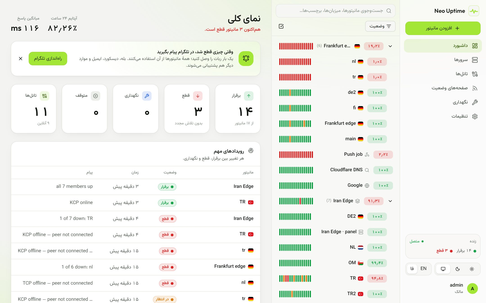
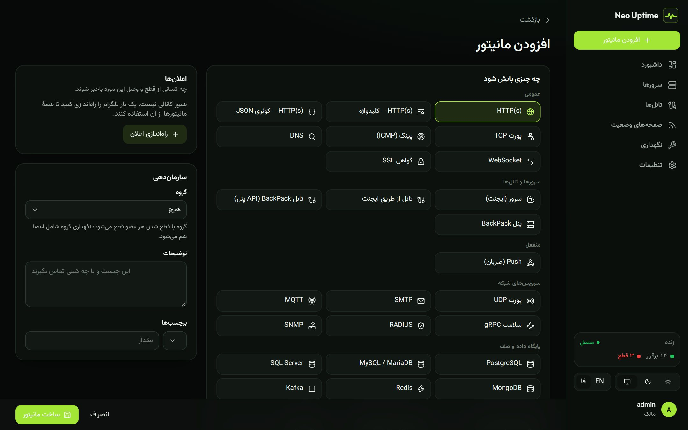
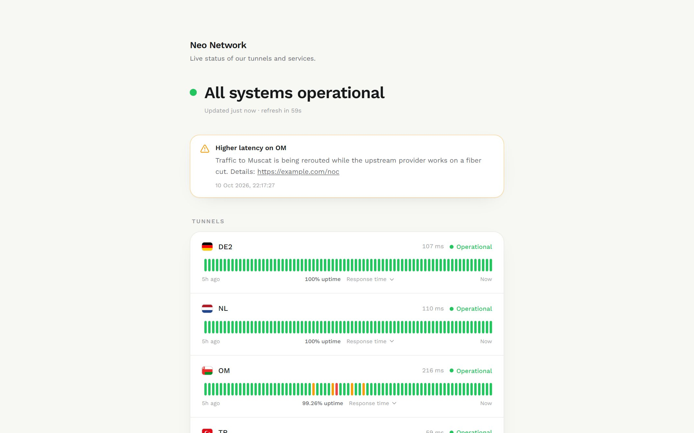
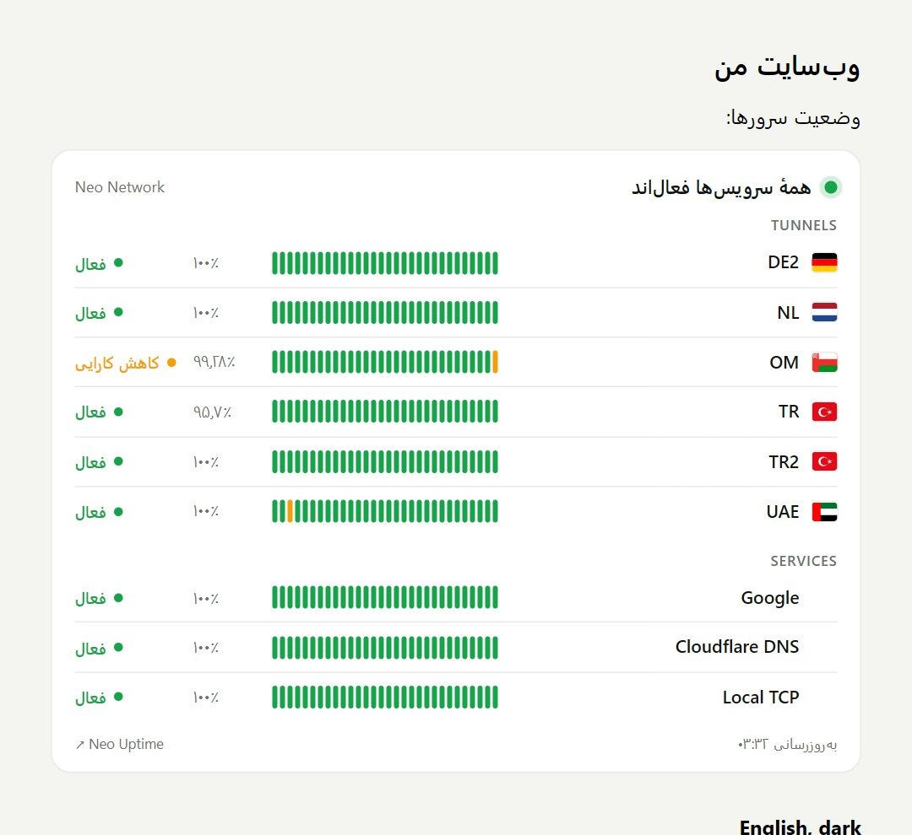

<div align="center">


# Neo Uptime

**Self-hosted uptime monitoring with first-class [BackPack](https://github.com/AminMGMT/BackPack) and [Kariz](https://github.com/Erfan-XRay/Kariz) tunnel support.**
Uptime Kuma-style monitors, a full admin panel in English and فارسی, five status-page themes and a private status API — in one small binary.

[Install](#install) · [Servers & agent](#servers-backpack-and-kariz-on-other-machines) · [Status pages](#status-pages) · [Status API](#show-your-status-on-your-own-website) · [فارسی](#فارسی)


</div>

## Install

On a Linux server (Ubuntu, Debian, CentOS, Alma, …), as root:

```bash
bash <(curl -fsSL https://raw.githubusercontent.com/neoauroraproject/Neo-Uptime/main/install.sh)
```

Then open `http://SERVER-IP:7788` and create the owner account. Running the same command again upgrades in place and keeps every monitor and all history.

| Option | |
|---|---|
| `--port 8080` | listen on another port (default `7788`) |
| `--version v1.1.0` | install a specific release |
| `--mirror https://your-gh-proxy/` | download through a GitHub mirror when GitHub is slow or filtered |
| `--uninstall` / `--uninstall --purge` | remove the service (and, with `--purge`, the data) |

Supported CPUs: `amd64`, `arm64`, `armv7`. The binary is static: no Node, no database server, no Docker needed.

<details>
<summary>Docker instead</summary>

```bash
docker run -d --name neo-uptime --restart=always -p 7788:7788 \
  -v neo-uptime:/data --cap-add NET_RAW ghcr.io/neoauroraproject/neo-uptime:latest
```
</details>

## Features

- **28 monitor types**, grouped like Uptime Kuma's:
  - *General:* HTTP(s), HTTP keyword, HTTP JSON query, TCP port, ping (ICMP), DNS, WebSocket, SSL certificate.
  - *Servers & tunnels:* server (agent), tunnel via agent (BackPack or Kariz), BackPack tunnel and BackPack panel through the panel API.
  - *Passive:* push (heartbeat, Kuma compatible).
  - *Network services:* UDP port, SMTP, MQTT, gRPC health, RADIUS, SNMP.
  - *Databases & queues:* PostgreSQL, MySQL/MariaDB, SQL Server, MongoDB, Redis, Kafka.
  - *Other:* Docker container, Steam game server, group.
- **Kuma-style checks:** per-monitor intervals, retries with their own interval, timeouts, upside-down mode, re-sent alerts while down, and TLS certificate expiry warnings.
- **Alerts where you are:** Telegram (finds your chat ID for you, and works through a custom API server or proxy when it is filtered), Bale, Discord, Slack/Mattermost, Microsoft Teams, Google Chat, email (SMTP), webhook, ntfy, Gotify and Pushover. Each channel sends in English or Persian.
- **A server agent** that reads BackPack and Kariz on the machine they run on and pushes everything to Neo Uptime with a token — so Neo Uptime can live anywhere.
- **Live dashboard:** a two-pane monitor list with heartbeat bars, groups, tags, search, filters and bulk pause/resume/delete, updated over a server-sent event stream.
- **Monitor pages:** response-time charts (live, 3h, 24h, 7d, 30d), 24h/30d/1-year uptime, important events and full check history.
- **Status pages:** as many as you like, in five themes (including the minimal **Zen**), in English or Persian, with country flags, incidents, scheduled maintenance and a live preview editor.
- **Private status API** and an embeddable widget for your own website. Only the owner can create its keys.
- **Country flags** for every server and tunnel. They are bundled SVGs, not emoji, so they look right on Windows too.
- **Persian UI:** right-to-left layout, Persian digits and Solar Hijri dates, switchable per browser.
- **Admin:** an owner account plus admin, editor and viewer roles, two-factor sign-in (TOTP), per-device sessions, scoped and expiring API keys, and JSON backup/restore.
- **Integrations:** a Prometheus `/metrics` endpoint (with Kuma's metric names) and SVG badges for status, uptime, response time and certificate expiry.
- **Light and dark themes.** Fonts and flags are bundled, so nothing loads from Google or any CDN.

<table>
<tr><td></td><td></td></tr>
<tr><td></td><td></td></tr>
</table>

## Servers: BackPack and Kariz on other machines

Neo Uptime does not have to run next to your tunnels. Install the small agent on each server instead:

1. In Neo Uptime go to **Servers → Add a server**, give it a name and a flag, and click **Create & show install command**.
2. Run the command it shows on that server, as root. It looks like this:

   ```bash
   bash <(curl -fsSL https://raw.githubusercontent.com/neoauroraproject/Neo-Uptime/main/agent.sh) \
     --server https://uptime.example.com --token na_xxxxxxxx
   ```

3. Within seconds the server shows up as online. Its BackPack and Kariz tunnels are added as monitors in a group named after the server.

The agent only sends: it opens no port and nothing connects to it. Every 20 seconds it reports:

- **The server:** CPU, load, memory, swap, disk, network rate and TCP connections.
- **BackPack:** each tunnel in `/etc/backpack/*.toml`, its live `*.metrics.json` (connection, traffic, peer, forwarded service) and its systemd unit. No panel token is needed.
- **Kariz:** each tunnel in `/etc/kariz/*.toml`, its control socket (`status` → peer, sessions, RTT, traffic, forwards) and its `kariz@<name>` unit.
- **Latency:** an ICMP ping to each tunnel's peer.

| Agent option | |
|---|---|
| `--interval 30` | seconds between reports (default 20) |
| `--insecure` | accept a self-signed Neo Uptime certificate |
| `--backpack-api URL --backpack-token T` | read BackPack through its panel API instead of its files |
| `--mirror https://your-gh-proxy/` | download through a GitHub mirror |
| `--uninstall` | remove the agent |

`neo-uptime-agent test` (run it on the server) prints what the agent found and whether Neo Uptime accepted it.

## Monitor BackPack tunnels through the panel API

If Neo Uptime can reach a BackPack panel, you can also connect the panel directly. Neo Uptime reads the same read-only API that BackPack documents for Prometheus, so it never touches a tunnel's config.

1. In the **BackPack web panel** go to **Settings → Security → API tokens**, create a token with scope **read** and name it `neo-uptime`.
2. In Neo Uptime go to **Tunnels → Panels → Connect panel**. Paste the panel address exactly as you open it, including the port and any secret path (for example `https://1.2.3.4:7777`), then paste the token and click **Test connection**.
3. Save. Every tunnel becomes a monitor inside a group named after the panel, together with a panel-health monitor (host CPU, RAM and disk). With **auto-import** on, tunnels you add in BackPack later show up on their own.

Each tunnel monitor records its online state, real latency, traffic in and out, uptime, transport, preset, port, peer location, KCP loss and connection pool. A tunnel that is up while the service behind it refuses connections can be counted as down: turn this on per monitor.

## Telegram alerts

1. Create a bot with [@BotFather](https://t.me/BotFather) and copy its token.
2. Send any message to the bot, or add it to your group or channel.
3. In Neo Uptime open **Settings → Notifications → Add channel → Telegram**, paste the token and press **Find chats**. Pick the chat, choose the message language and send a test.

Turn on **On by default** and every new monitor, server and imported tunnel uses the channel. When `api.telegram.org` is filtered, set **API server** to a relay (for example a Cloudflare Worker) or set a **Proxy** (`socks5://…`).

## Push monitors (Uptime Kuma compatible)

A push monitor gives you a URL in the same format as Kuma's:

```bash
curl -fsS "https://uptime.example.com/api/push/<token>?status=up&msg=OK&ping="
```

Scripts written for Kuma keep working after you change the host. If the URL is not called within the interval, the monitor goes down.

## Status pages

| Zen | Zen, Persian and dark |
|---|---|
|  |  |
| **Aurora** | **Clarity** |
|  |  |
| **Lime** | **Noir** |
|  |  |

**Zen** is the default for new pages. It shows only the status: a headline, then one quiet row per server with its flag, its bars and its uptime. It follows the visitor's light or dark setting. Each page can be in English, Persian, or follow the visitor's browser, and can hide the banner, uptime, latency and charts.

Each page is served at `/status/<slug>`. Any one of them can also be shown at the site root: **Settings → General → Root address opens**.

## Show your status on your own website

The owner account (the first account created) can hand out private keys to a status page under **Settings → Status API**. A key reads one page only, and can be limited to your site's address.

**Widget:** paste this into any page. It renders the servers with their flags and refreshes every minute.

```html
<div id="neo-status"></div>
<script src="https://uptime.example.com/embed.js" data-target="#neo-status"
  data-server="https://uptime.example.com" data-slug="main" data-key="sk_…"
  data-lang="fa" data-theme="auto" async></script>
```

`data-lang` is `fa` or `en`. `data-theme` is `auto`, `light` or `dark`.



**JSON:** call the API from your own code. The key can also be passed as `?key=`.

```bash
curl -H "Authorization: Bearer sk_…" https://uptime.example.com/api/v1/status/main
```

```json
{
  "overall": "operational",
  "groups": [{
    "name": "Tunnels",
    "monitors": [{ "name": "DE2", "country": "de", "status": "up", "latencyMs": 92,
                   "uptime24h": 0.9995, "uptime30d": 0.9981, "history": ["u","u","d","u"] }]
  }],
  "incidents": [], "maintenance": []
}
```

`overall` is `operational`, `partial_outage`, `major_outage`, `maintenance` or `unknown`. A monitor's `status` is `up`, `down`, `pending`, `maintenance`, `paused` or `unknown`.

## Configuration

`/etc/neo-uptime/neo-uptime.env` (restart after editing: `systemctl restart neo-uptime`):

```ini
NEO_UPTIME_HOST=0.0.0.0
NEO_UPTIME_PORT=7788
NEO_UPTIME_DATA=/var/lib/neo-uptime
# Serve HTTPS directly; renewed certificates are picked up without a restart.
#NEO_UPTIME_TLS_CERT=/etc/letsencrypt/live/uptime.example.com/fullchain.pem
#NEO_UPTIME_TLS_KEY=/etc/letsencrypt/live/uptime.example.com/privkey.pem
```

Set **Settings → General → Public address** so that alert links, push URLs and agent install commands use your real address.

Behind nginx, turn on **Settings → General → Behind a reverse proxy** and keep the event stream unbuffered:

```nginx
location / {
    proxy_pass http://127.0.0.1:7788;
    proxy_set_header Host $host;
    proxy_set_header X-Forwarded-For $proxy_add_x_forwarded_for;
    proxy_set_header X-Forwarded-Proto $scheme;
    proxy_buffering off;
}
```

### Command line

```bash
neo-uptime reset-password <user> [new-password]   # prints a new password if none is given
neo-uptime disable-2fa <user>                     # lost phone
neo-uptime set-owner <user>                       # hand the owner role to another admin
neo-uptime list-users
neo-uptime version
journalctl -u neo-uptime -f                       # logs
journalctl -u neo-uptime-agent -f                 # agent logs, on a monitored server
```

### API

Create a key under **Settings → API keys**. Read keys can call `GET /api/*` and `/metrics`. Write keys can also create and change monitors, status pages and maintenance. Keys can never manage users, keys or backups.

```bash
curl -H "Authorization: Bearer nu_…" https://uptime.example.com/api/monitors
```

## Development

```bash
make dev     # mock BackPack panel on :7777 (token: test-token), API on :7788, UI with hot reload on :5173
make test    # go vet + go test
make linux   # release archives in dist/ (server and agent)
```

The backend is Go, using SQLite through a pure-Go driver (no CGO). The UI is React, TypeScript, Vite and Tailwind CSS, and it is embedded in the binary. The agent is a separate ~7 MB binary with no database.

## License

[MIT](LICENSE). Flags from [flag-icons](https://github.com/lipis/flag-icons) (MIT).

---

<div dir="rtl">

## فارسی

**Neo Uptime** یک سیستم مانیتورینگ آپتایم خودمیزبان شبیه Uptime Kuma است که از تانل‌های **BackPack** و **Kariz** به‌صورت مستقیم پشتیبانی می‌کند. پنل مدیریت کاملاً فارسی است: راست‌به‌چپ، با اعداد فارسی و تاریخ شمسی.

### نصب با یک دستور

روی سرور لینوکس و با کاربر root این دستور را اجرا کنید:

```bash
bash <(curl -fsSL https://raw.githubusercontent.com/neoauroraproject/Neo-Uptime/main/install.sh)
```

بعد آدرس `http://IP-سرور:7788` را باز کنید و حساب مالک را بسازید. اجرای دوباره‌ی همین دستور برنامه را آپدیت می‌کند و داده‌ها حفظ می‌شوند. زبان پنل را از پایین منو (EN / فا) یا **تنظیمات ← ظاهر و زبان** عوض کنید.

- اگر GitHub کند یا فیلتر است، از `--mirror https://آدرس-میرور/` استفاده کنید.
- برای تغییر پورت از `--port 8080` استفاده کنید.
- برای حذف برنامه از `--uninstall` استفاده کنید.

### سرورهای دیگر: ایجنت برای BackPack و Kariz

لازم نیست Neo Uptime روی همان سروری باشد که تانل‌ها روی آن هستند. روی هر سرور ایجنت کوچک را نصب کنید:

۱. در Neo Uptime به **سرورها ← افزودن سرور** بروید، نام و پرچم کشور را انتخاب کنید و **ساختن و نمایش دستور نصب** را بزنید.

۲. دستوری را که نشان می‌دهد روی همان سرور با کاربر root اجرا کنید:

```bash
bash <(curl -fsSL https://raw.githubusercontent.com/neoauroraproject/Neo-Uptime/main/agent.sh) \
  --server https://uptime.example.com --token na_xxxxxxxx
```

۳. ظرف چند ثانیه سرور آنلاین می‌شود و تانل‌های BackPack و Kariz آن خودکار به مانیتور تبدیل می‌شوند.

ایجنت فقط داده ارسال می‌کند و هیچ پورتی باز نمی‌کند. هر ۲۰ ثانیه این‌ها را با توکن به Neo Uptime می‌فرستد: پردازنده، رم، دیسک و ترافیک سرور، تانل‌های BackPack (از فایل‌های `/etc/backpack`، بدون نیاز به توکن پنل)، تانل‌های Kariz (از سوکت کنترلی در `/etc/kariz`) و پینگ هر تانل.

### اتصال مستقیم به پنل BackPack

اگر Neo Uptime به پنل BackPack دسترسی دارد، می‌توانید پنل را مستقیم هم وصل کنید:

۱. در پنل وب BackPack به **Settings → Security → API tokens** بروید و یک توکن با سطح دسترسی **read** بسازید.

۲. در Neo Uptime به **تانل‌ها ← پنل‌ها ← اتصال پنل** بروید. آدرس پنل را دقیقاً همان‌طور که در مرورگر باز می‌کنید وارد کنید، با پورت و مسیر مخفی اگر دارد. توکن را هم وارد کنید و **آزمایش اتصال** را بزنید.

۳. ذخیره کنید. همه‌ی تانل‌ها خودکار به مانیتور تبدیل می‌شوند. Neo Uptime فقط API خواندنی BackPack را می‌خواند و هیچ تنظیمی از تانل‌ها را تغییر نمی‌دهد.

### هشدار تلگرام

۱. با [@BotFather](https://t.me/BotFather) یک ربات بسازید و توکنش را کپی کنید.

۲. یک پیام به ربات بفرستید (یا آن را به گروه یا کانال خود اضافه کنید).

۳. در **تنظیمات ← اعلان‌ها ← افزودن کانال ← تلگرام** توکن را وارد کنید و **یافتن چت‌ها** را بزنید. چت را انتخاب کنید، زبان پیام را **فارسی** بگذارید و پیام آزمایشی بفرستید.

اگر api.telegram.org فیلتر است، در فیلد **سرور API** آدرس یک رله (مثلاً Cloudflare Worker) یا در فیلد **پراکسی** یک `socks5://` وارد کنید.

### صفحه‌ی وضعیت و API خصوصی

- پوسته‌ی **Zen** (پیش‌فرض): فقط وضعیت، بدون هیچ چیز اضافه؛ روشن یا تیره مطابق دستگاه بازدیدکننده، با پرچم هر سرور.
- هر صفحه می‌تواند فارسی، انگلیسی یا خودکار (مطابق مرورگر) باشد.
- **API وضعیت:** فقط حساب مالک (اولین حسابی که ساخته شده) می‌تواند در **تنظیمات ← API وضعیت** کلید خصوصی بسازد. هر کلید فقط یک صفحه را می‌خواند و می‌شود آن را به آدرس سایت خودتان محدود کرد. با ویجت آماده (`embed.js`) یا با فراخوانی `GET /api/v1/status/<slug>` وضعیت را در سایت خودتان نشان دهید. نمونه‌ی کد در بخش انگلیسی بالا هست.

### امکانات

- **۲۸ نوع مانیتور:** HTTP، Keyword، JSON، TCP، Ping، DNS، WebSocket، گواهی SSL، سرور (ایجنت)، تانل از طریق ایجنت، تانل و پنل BackPack، Push، UDP، SMTP، MQTT، gRPC، RADIUS، SNMP، PostgreSQL، MySQL، SQL Server، MongoDB، Redis، Kafka، Docker، سرور بازی Steam و گروه.
- **۱۱ کانال اعلان:** تلگرام، بله، دیسکورد، اسلک، Teams، ایمیل، وب‌هوک و چند کانال دیگر، با پیام فارسی یا انگلیسی.
- **پرچم کشور** برای هر سرور و تانل، به‌صورت تصویر SVG (نه ایموجی) که در ویندوز هم درست دیده می‌شود.
- **پنل ادمین کامل:**
  - حساب مالک و نقش‌های admin، editor و viewer
  - ورود دومرحله‌ای (2FA)
  - مدیریت دستگاه‌هایی که وارد حساب شده‌اند
  - کلید API
  - بکاپ و بازگردانی
  - پنجره‌ی تعمیرات (maintenance)
- **سازگار با Push در Uptime Kuma:** اسکریپت‌های فعلی‌تان فقط با عوض کردن دامنه کار می‌کنند.
- **فونت‌ها و پرچم‌ها داخل خود برنامه هستند:** هیچ چیزی از Google یا CDN بارگذاری نمی‌شود، پس برای سرورهای ایران مشکلی ندارد.

### بازیابی رمز

اگر رمز را فراموش کردید، این دستور را روی سرور اجرا کنید:

```bash
neo-uptime reset-password admin
```

</div>
